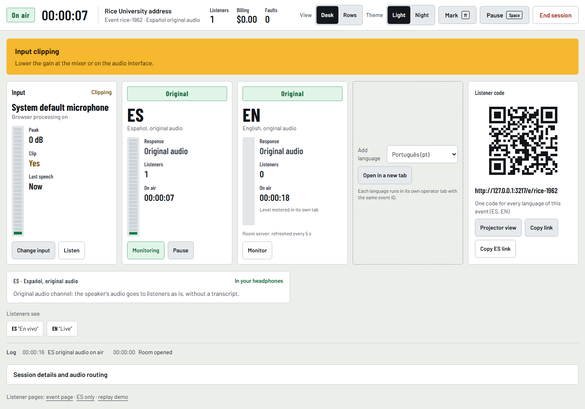
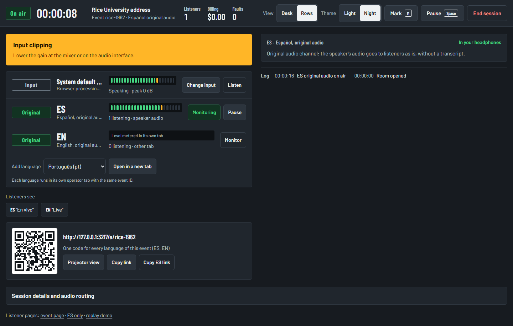
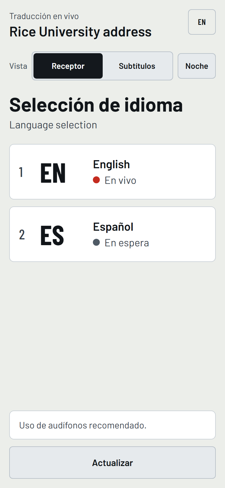
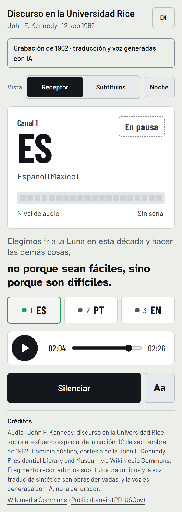
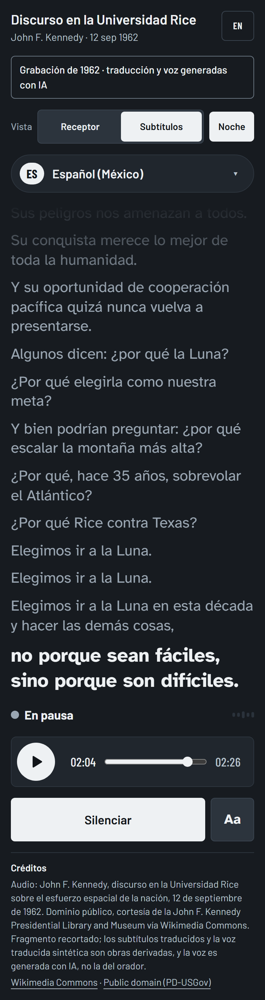
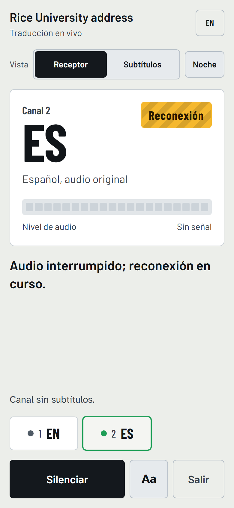
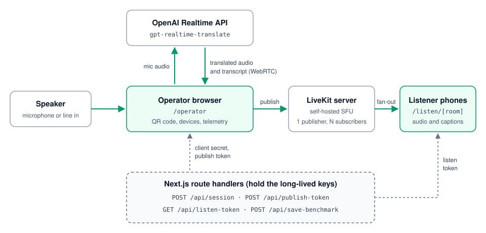

# live-translation

Real-time speech translation for live talks: one speaker, one realtime translation session, any number of listeners on their own phones.

## What it does

The app has three surfaces.

- **Operator** (`/operator`): a dashboard on the laptop that receives the speaker's audio. Setup takes the event ID and title, the language, the input (with a level test) and the channel type: speech translation, or the speaker's original audio for listeners of the source language. Once the room is open, the dashboard shows an input meter, an output meter and the on-air state of each language of the event, one alert at a time with its fix, the transcript, the event QR code with a projector view, and session details (connections, response time, cost, event log). Two views: **Desk** (vertical channel strips, transcript lanes below) and **Rows** (horizontal channel rows, alert slot, transcript at reading size). Keyboard: Space starts or pauses, M places a mark.
- **Listeners** (`/listen/[room]`): a mobile web page opened from the QR code. It joins the room as a subscribe-only participant and plays the translated audio with captions. Two views: **Receiver** (channel card with live light and level meter, last caption lines, channel buttons) and **Captions** (caption stage, channel code on the language button). The page states whether the broadcast is live, paused, reconnecting or silent, rejoins on its own after a network drop, keeps the screen on while listening and shows the stream on the lock screen. The interface follows the room language (Spanish or English) and can be switched by hand.
- **Event page** (`/e/[event]`): one link and QR code for the whole event. It lists the languages of the event that currently have a room open, with their state, and listeners can come back to it to switch language without scanning another code.

Every surface has a light theme (default) and a **Night** theme for dark rooms. Theme and view are remembered per device.

**Replay** (`/replay` and `/replay/operator`): a recorded 1962 speech with translated captions and AI-generated voices in Spanish and Portuguese, played through the same listener and operator views. It needs no keys and calls no server route, so it also works from a static export. Credits and licence are in `public/replay/ATTRIBUTION.txt`.

Translation runs on OpenAI's `gpt-realtime-translate` model. The translated audio is fanned out through a self-hosted [LiveKit](https://livekit.io) server, so the translation cost does not grow with the number of listeners.

## Screenshots

<table>
  <tr>
    <td colspan="3">
      
      <p align="center"><sub>Operator, Desk view: the input and each language as a channel strip, the event QR code and what listeners see.</sub></p>
    </td>
  </tr>
  <tr>
    <td colspan="3">
      
      <p align="center"><sub>Operator, Rows view, Night theme.</sub></p>
    </td>
  </tr>
  <tr>
    <td width="33%">
      
      <p align="center"><sub>Event page: one code, every language.</sub></p>
    </td>
    <td width="33%">
      
      <p align="center"><sub>Listener, Receiver view (replay).</sub></p>
    </td>
    <td width="33%">
      
      <p align="center"><sub>Listener, Captions view, Night theme (replay).</sub></p>
    </td>
  </tr>
  <tr>
    <td width="33%">
      
      <p align="center"><sub>Network drop: the page rejoins on its own.</sub></p>
    </td>
    <td colspan="2"></td>
  </tr>
</table>

## How it works

<p align="center">
  
</p>

1. The operator browser requests a short-lived OpenAI client secret from the server and opens a WebRTC session with `gpt-realtime-translate`. Microphone audio goes in; translated audio and transcript come back.
2. The operator browser requests a publish-only LiveKit token and republishes the translated audio track to the room, with caption text on a data channel. Its session state (waiting, live, paused, reconnecting, interrupted, ended), the event title and the last response time travel as participant attributes, so listeners and the event page know what is happening.
3. Each listener requests a subscribe-only LiveKit token for the room and plays the track.

Long-lived keys (`OPENAI_API_KEY`, `LIVEKIT_API_SECRET`, `GOOGLE_AI_API_KEY`) are read only inside Next.js route handlers. The browser only receives short-lived, scoped credentials:

| Route | Returns |
|---|---|
| `POST /api/session` | OpenAI ephemeral client secret for one translation session |
| `POST /api/publish-token` | LiveKit JWT that can publish to one room (6 h TTL) |
| `GET /api/listen-token` | LiveKit JWT that can only subscribe to one room (6 h TTL) |
| `GET /api/event-languages` | Languages of one event that have an operator connected, with each one's state and listener count. No credentials are returned; results are cached for 5 s per event and requests are rate limited per client |
| `POST /api/gemini-token` | Gemini Live ephemeral token (experimental, not used by the UI) |
| `POST /api/save-benchmark` | Writes the session report to `benchmarks/` on the server |

A session has four steps on the operator dashboard:

1. **Open room**: the QR code goes live and listeners can join and wait. Nothing is billed.
2. **Start translation** (or **Start original audio**): the OpenAI session opens and billing starts. Original audio sends the speaker's audio as is and bills nothing.
3. **Pause**: the translation session closes but listeners stay connected and see "Paused between speakers". Use it between speakers and during breaks.
4. **End session**: after a confirmation, everything is torn down, listeners see "Session ended" and the session report is written.

Each language runs in its own operator tab with the same event ID ("Add language" opens one). Every tab shows the other languages of the event as strips with their state, listener count and response time, read from the room server every 5 seconds; their level meters and transcripts are only available in their own tab.

Stack: Next.js 16 (App Router), React 19, TypeScript, Tailwind CSS 4, `livekit-client`, `livekit-server-sdk`, `qrcode.react`.

## Requirements

- Node.js 20 or newer
- Docker, to run the LiveKit server
- An OpenAI API key with access to `gpt-realtime-translate`
- The operator laptop and the listeners' phones on the same network

## Quick start

1. Start LiveKit in dev mode. Replace `192.168.1.50` with the laptop's LAN IP:

   ```bash
   docker run -d --name livekit-dev \
     -p 7880:7880 -p 7881:7881 -p 7882:7882/udp \
     livekit/livekit-server --dev --bind 0.0.0.0 --node-ip 192.168.1.50
   ```

2. Install dependencies and create the local environment file:

   ```bash
   npm install
   cp .env.example .env.local
   ```

   Set at least these values in `.env.local`:

   ```
   OPENAI_API_KEY=<your key>
   LIVEKIT_API_KEY=devkey
   LIVEKIT_API_SECRET=secret
   NEXT_PUBLIC_LIVEKIT_URL=ws://192.168.1.50:7880
   NEXT_PUBLIC_LISTENER_BASE_URL=http://192.168.1.50:3000
   ALLOWED_DEV_ORIGINS=192.168.1.50
   ```

   `devkey` and `secret` are the credentials built into LiveKit's `--dev` mode.

3. Run the app:

   ```bash
   npm run dev
   ```

4. Open `http://localhost:3000/operator`, click **Open room**, scan the QR code with a phone on the same network, tap **Listen**, then click **Start translation**.

With only `OPENAI_API_KEY` set, the dashboard runs without rooms or QR codes and plays the translation on the laptop.

`npm run build` succeeds with every variable empty, because keys are read at request time.

[docs/OPERATIONS.md](docs/OPERATIONS.md) covers LAN setup, audio routing, the telemetry panel and troubleshooting.

## Configuration

All variables are documented in [`.env.example`](.env.example).

| Variable | Required | Description |
|---|---|---|
| `OPENAI_API_KEY` | Yes | Server-side key used by `/api/session` to mint client secrets. |
| `OPENAI_SAFETY_IDENTIFIER` | No | Value sent as the `OpenAI-Safety-Identifier` header. Defaults to `live-translation-anon`. |
| `LIVEKIT_API_KEY` | For rooms | LiveKit API key used to sign room tokens. |
| `LIVEKIT_API_SECRET` | For rooms | LiveKit API secret used to sign room tokens. |
| `NEXT_PUBLIC_LIVEKIT_URL` | For rooms | WebSocket URL of the LiveKit server. Empty disables rooms and QR codes. |
| `LIVEKIT_API_URL` | No | HTTP(S) URL the server uses to query LiveKit for the event page. Defaults to `NEXT_PUBLIC_LIVEKIT_URL` with `ws` replaced by `http`. |
| `NEXT_PUBLIC_LISTENER_BASE_URL` | No | Base URL for the listener link and QR code. Must be reachable from phones. Falls back to the page origin and can be edited in the UI. |
| `GOOGLE_AI_API_KEY` | No | Only for the experimental Gemini Live engine, which is hidden in the UI. |
| `ALLOWED_DEV_ORIGINS` | No | Comma-separated hosts allowed to load dev assets under `npm run dev`. Needed for phones on the LAN. |

`NEXT_PUBLIC_` values are inlined into the client bundle at build time and must never hold a secret.

## Cost

The on-screen estimate uses the per-minute rates set in `lib/telemetry.ts`. They are not fetched live; check the providers' current pricing.

| Item | Rate used by the estimate |
|---|---|
| `gpt-realtime-translate` | USD 0.034 per minute while a translation session is open |
| `gpt-realtime-whisper` source transcript (optional "Capture source") | USD 0.017 per minute |
| Self-hosted LiveKit | No per-listener charge |

The translation session bills for as long as it is open, whether or not anyone is speaking, and independently of the number of listeners.

## Limitations and roadmap

- No authentication on the API routes. Anyone who can reach the server can mint OpenAI and LiveKit credentials. Run it on a trusted network only, and do not expose it to the internet without adding auth.
- LiveKit runs in `--dev` mode. A public deployment needs a real LiveKit configuration, generated keys and TLS.
- One target language per room. Several languages need several operator tabs with the same event ID; the event link groups them for listeners.
- No PWA manifest; the listener page is a plain mobile web page.
- The Gemini Live engine (`lib/gemini-live.ts`, `/api/gemini-token`) is kept in the code but hidden in the UI.
- The response time shown is first-token latency, not end-to-end audio latency.
- Tests: `npm test` (unit), `npm run test:e2e` (both views and themes on every surface, contrast, 320 px layout, target sizes, replay) and `npm run check:contrast` (colour tokens). With a LiveKit dev server, `E2E_LIVEKIT=1` adds the room flow; the setup is at the top of `tests/e2e/livekit.spec.ts`. The translation engine itself is tested by hand, since it needs an OpenAI key.

## Privacy

When the operator ends a session, the dashboard sends a session report to `/api/save-benchmark`, which writes it to `benchmarks/` in the project directory on the machine running the server. The report contains transcripts and, where the browser supports `MediaRecorder`, recordings of the speaker's microphone and of the translated output. Nothing is uploaded elsewhere, and the folder is git-ignored.

Inform speakers that sessions are recorded, or remove the recorder calls in `app/operator/page.tsx` to disable recording.

## License

[MIT](LICENSE)
