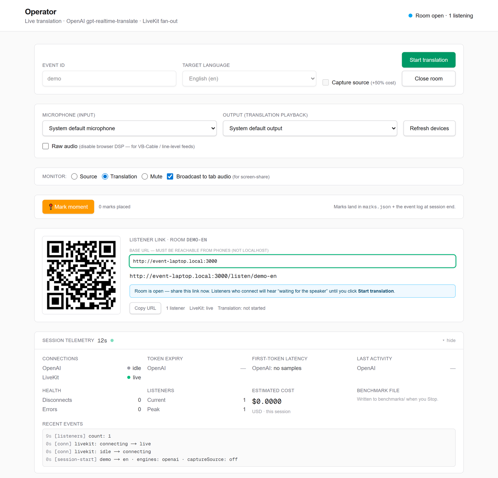
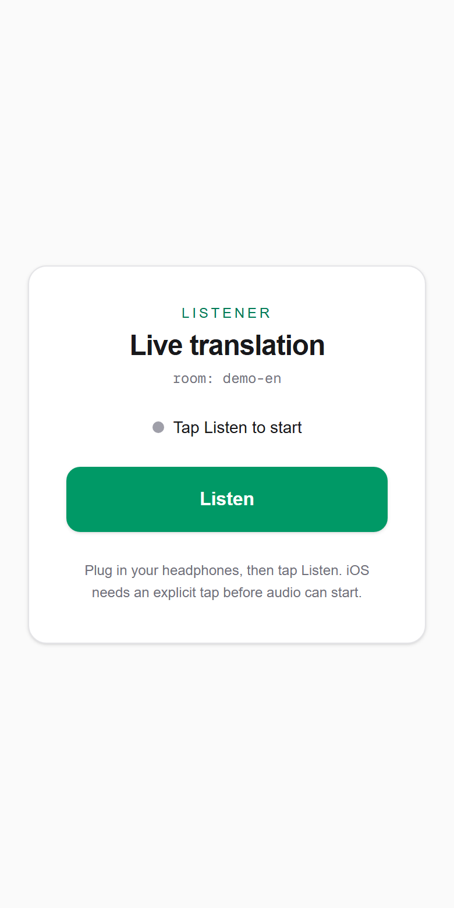
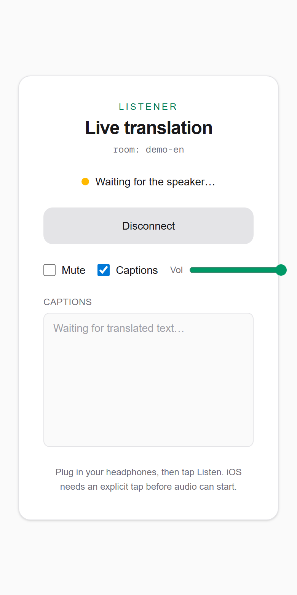
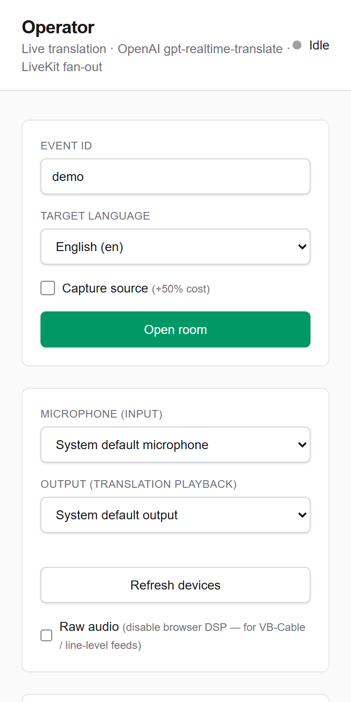
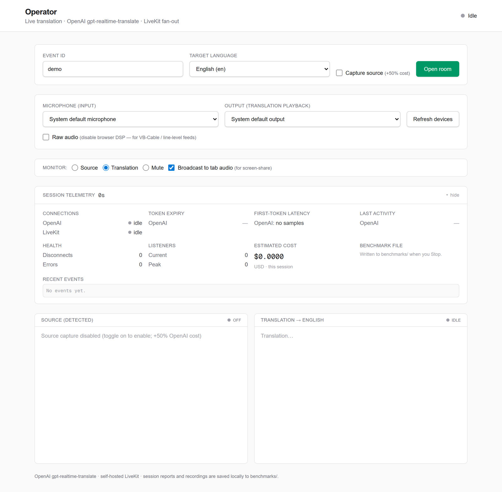

# live-translation

Real-time speech translation for live talks: one speaker, one realtime translation session, any number of listeners on their own phones.

## What it does

The app has two roles.

- **Operator** (`/operator`): a dashboard on the laptop that receives the speaker's audio. The operator picks the target language and audio devices, opens a room, shares the listener QR code, starts and stops translation between speakers, and follows live session telemetry (connection state, token expiry, first-token latency, listener count, estimated cost).
- **Listeners** (`/listen/[room]`): a mobile web page opened from the QR code. It joins the room as a subscribe-only participant and plays the translated audio, with volume, mute and live captions. Nothing to install.

Translation runs on OpenAI's `gpt-realtime-translate` model. The translated audio is fanned out through a self-hosted [LiveKit](https://livekit.io) server, so the translation cost does not grow with the number of listeners.

## Screenshots

<table>
  <tr>
    <td colspan="3">
      
      <p align="center"><sub>Operator dashboard with a room open: listener QR code and link, one listener connected, session telemetry.</sub></p>
    </td>
  </tr>
  <tr>
    <td width="33%">
      
      <p align="center"><sub>Listener page opened from the QR code.</sub></p>
    </td>
    <td width="33%">
      
      <p align="center"><sub>Connected and waiting for translation to start. Captions appear below.</sub></p>
    </td>
    <td width="33%">
      
      <p align="center"><sub>Operator dashboard on a narrow screen.</sub></p>
    </td>
  </tr>
  <tr>
    <td colspan="3">
      
      <p align="center"><sub>Operator dashboard before a room is opened: target language, input and output devices, monitor options and transcript panels.</sub></p>
    </td>
  </tr>
</table>

## How it works

<p align="center">
  
</p>

1. The operator browser requests a short-lived OpenAI client secret from the server and opens a WebRTC session with `gpt-realtime-translate`. Microphone audio goes in; translated audio and transcript come back.
2. The operator browser requests a publish-only LiveKit token and republishes the translated audio track to the room, with caption text on a data channel.
3. Each listener requests a subscribe-only LiveKit token for the room and plays the track.

Long-lived keys (`OPENAI_API_KEY`, `LIVEKIT_API_SECRET`, `GOOGLE_AI_API_KEY`) are read only inside Next.js route handlers. The browser only receives short-lived, scoped credentials:

| Route | Returns |
|---|---|
| `POST /api/session` | OpenAI ephemeral client secret for one translation session |
| `POST /api/publish-token` | LiveKit JWT that can publish to one room (6 h TTL) |
| `GET /api/listen-token` | LiveKit JWT that can only subscribe to one room (6 h TTL) |
| `POST /api/gemini-token` | Gemini Live ephemeral token (experimental, not used by the UI) |
| `POST /api/save-benchmark` | Writes the session report to `benchmarks/` on the server |

A session has four steps on the operator dashboard:

1. **Open room**: the QR code goes live and listeners can join and wait. Nothing is billed.
2. **Start translation**: the OpenAI session opens and billing starts.
3. **Stop translation**: the translation session closes but listeners stay connected. Use it between speakers and during breaks.
4. **Close room**: everything is torn down and the session report is written.

Stack: Next.js 16 (App Router), React 19, TypeScript, Tailwind CSS 4, `livekit-client`, `livekit-server-sdk`, `qrcode.react`.

## Requirements

- Node.js 20 or newer
- Docker, to run the LiveKit server
- An OpenAI API key with access to `gpt-realtime-translate`
- The operator laptop and the listeners' phones on the same network

## Quick start

1. Start LiveKit in dev mode. Replace `192.168.1.50` with the laptop's LAN IP:

   ```bash
   docker run -d --name livekit-dev \
     -p 7880:7880 -p 7881:7881 -p 7882:7882/udp \
     livekit/livekit-server --dev --bind 0.0.0.0 --node-ip 192.168.1.50
   ```

2. Install dependencies and create the local environment file:

   ```bash
   npm install
   cp .env.example .env.local
   ```

   Set at least these values in `.env.local`:

   ```
   OPENAI_API_KEY=<your key>
   LIVEKIT_API_KEY=devkey
   LIVEKIT_API_SECRET=secret
   NEXT_PUBLIC_LIVEKIT_URL=ws://192.168.1.50:7880
   NEXT_PUBLIC_LISTENER_BASE_URL=http://192.168.1.50:3000
   ALLOWED_DEV_ORIGINS=192.168.1.50
   ```

   `devkey` and `secret` are the credentials built into LiveKit's `--dev` mode.

3. Run the app:

   ```bash
   npm run dev
   ```

4. Open `http://localhost:3000/operator`, click **Open room**, scan the QR code with a phone on the same network, tap **Listen**, then click **Start translation**.

With only `OPENAI_API_KEY` set, the dashboard runs without rooms or QR codes and plays the translation on the laptop.

`npm run build` succeeds with every variable empty, because keys are read at request time.

[docs/OPERATIONS.md](docs/OPERATIONS.md) covers LAN setup, audio routing, the telemetry panel and troubleshooting.

## Configuration

All variables are documented in [`.env.example`](.env.example).

| Variable | Required | Description |
|---|---|---|
| `OPENAI_API_KEY` | Yes | Server-side key used by `/api/session` to mint client secrets. |
| `OPENAI_SAFETY_IDENTIFIER` | No | Value sent as the `OpenAI-Safety-Identifier` header. Defaults to `live-translation-anon`. |
| `LIVEKIT_API_KEY` | For rooms | LiveKit API key used to sign room tokens. |
| `LIVEKIT_API_SECRET` | For rooms | LiveKit API secret used to sign room tokens. |
| `NEXT_PUBLIC_LIVEKIT_URL` | For rooms | WebSocket URL of the LiveKit server. Empty disables rooms and QR codes. |
| `NEXT_PUBLIC_LISTENER_BASE_URL` | No | Base URL for the listener link and QR code. Must be reachable from phones. Falls back to the page origin and can be edited in the UI. |
| `GOOGLE_AI_API_KEY` | No | Only for the experimental Gemini Live engine, which is hidden in the UI. |
| `ALLOWED_DEV_ORIGINS` | No | Comma-separated hosts allowed to load dev assets under `npm run dev`. Needed for phones on the LAN. |

`NEXT_PUBLIC_` values are inlined into the client bundle at build time and must never hold a secret.

## Cost

The on-screen estimate uses the per-minute rates set in `lib/telemetry.ts`. They are not fetched live; check the providers' current pricing.

| Item | Rate used by the estimate |
|---|---|
| `gpt-realtime-translate` | USD 0.034 per minute while a translation session is open |
| `gpt-realtime-whisper` source transcript (optional "Capture source") | USD 0.017 per minute |
| Self-hosted LiveKit | No per-listener charge |

The translation session bills for as long as it is open, whether or not anyone is speaking, and independently of the number of listeners.

## Limitations and roadmap

- No authentication on the API routes. Anyone who can reach the server can mint OpenAI and LiveKit credentials. Run it on a trusted network only, and do not expose it to the internet without adding auth.
- LiveKit runs in `--dev` mode. A public deployment needs a real LiveKit configuration, generated keys and TLS.
- One target language per room. Several languages need several operator tabs.
- No PWA manifest; the listener page is a plain mobile web page.
- A UI pass is pending.
- The Gemini Live engine (`lib/gemini-live.ts`, `/api/gemini-token`) is kept in the code but hidden in the UI.
- The latency shown is first-token latency, not end-to-end audio latency.
- No automated tests.

## Privacy

When the operator closes a room, the dashboard sends a session report to `/api/save-benchmark`, which writes it to `benchmarks/` in the project directory on the machine running the server. The report contains transcripts and, where the browser supports `MediaRecorder`, recordings of the speaker's microphone and of the translated output. Nothing is uploaded elsewhere, and the folder is git-ignored.

Inform speakers that sessions are recorded, or remove the recorder calls in `app/operator/page.tsx` to disable recording.

## License

[MIT](LICENSE)
